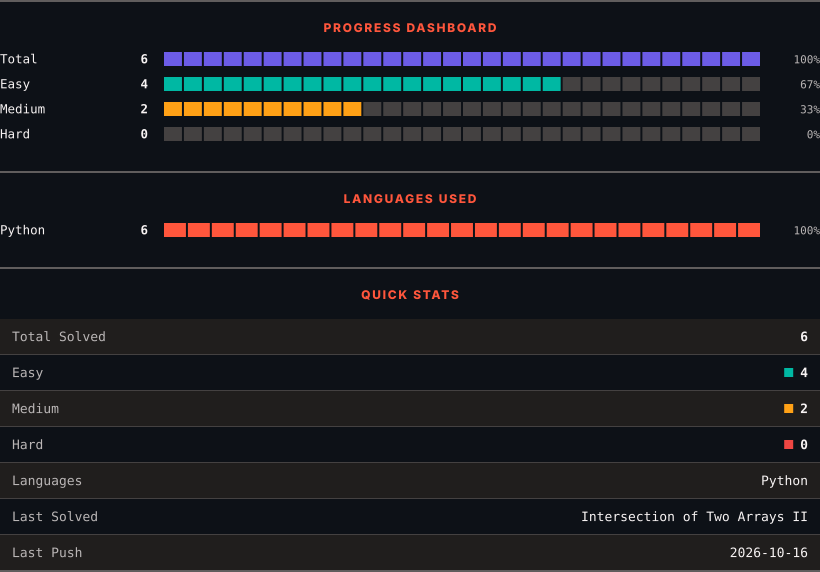
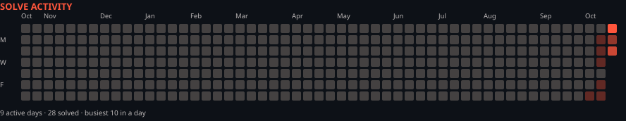

<h1>LeetCode Solutions</h1>

<em>Automatically synced with every accepted submission</em>

   

<picture>
  <source media="(prefers-color-scheme: dark)" srcset=".leetsync/stats-dark.svg">
  <source media="(prefers-color-scheme: light)" srcset=".leetsync/stats-light.svg">
  
</picture>

<picture>
  <source media="(prefers-color-scheme: dark)" srcset=".leetsync/calendar-dark.svg">
  <source media="(prefers-color-scheme: light)" srcset=".leetsync/calendar-light.svg">
  
</picture>

---

### ALL SOLUTIONS

| # | Problem | Difficulty | Language | Date |
|:---:|:--------|:----------:|:--------:|:----:|
| 1 | [Two Sum](problems/0001-Two-Sum) | 🟩 Easy | `Python` | 2026-10-10 |
| 89 | [Gray Code](problems/0089-Gray-Code) | 🟧 Medium | `Python` | 2026-10-16 |
| 130 | [Surrounded Regions](problems/0130-Surrounded-Regions) | 🟧 Medium | `Python` | 2026-10-14 |
| 190 | [Reverse Bits](problems/0190-Reverse-Bits) | 🟩 Easy | `Python` | 2026-10-12 |
| 194 | [Transpose File](problems/0194-Transpose-File) | 🟧 Medium | `bash` | 2026-10-17 |
| 225 | [Implement Stack using Queues](problems/0225-Implement-Stack-using-Queues) | 🟩 Easy | `Python` | 2026-10-13 |
| 350 | [Intersection of Two Arrays II](problems/0350-Intersection-of-Two-Arrays-II) | 🟩 Easy | `Python` | 2026-10-10 |
| 594 | [Longest Harmonious Subsequence](problems/0594-Longest-Harmonious-Subsequence) | 🟩 Easy | `Python` | 2026-10-18 |
| 595 | [Big Countries](problems/0595-Big-Countries) | 🟩 Easy | `MySQL` | 2026-10-18 |
| 596 | [Classes With at Least 5 Students](problems/0596-Classes-With-at-Least-5-Students) | 🟩 Easy | `MySQL` | 2026-10-18 |
| 598 | [Range Addition II](problems/0598-Range-Addition-II) | 🟩 Easy | `Python` | 2026-10-18 |
| 599 | [Minimum Index Sum of Two Lists](problems/0599-Minimum-Index-Sum-of-Two-Lists) | 🟩 Easy | `Python` | 2026-10-18 |

---

Auto-synced by <strong>LeetSync</strong> · Built by <a href="https://deveshsamant.in/">Devesh Samant</a>

