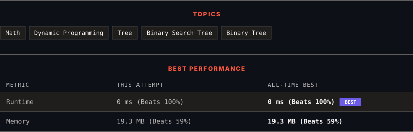

<div align="center">

# 96. Unique Binary Search Trees

      

[](https://leetcode.com/problems/unique-binary-search-trees/)

</div>

---

<div align="center">

<picture>
  <source media="(prefers-color-scheme: dark)" srcset="panel-dark.svg">
  <source media="(prefers-color-scheme: light)" srcset="panel-light.svg">
  
</picture>

</div>

> **New personal best** — Runtime improved on this submission.

### HOW IT WENT

| | |
|:--|:--|
| **Attempts** | first try |
| **Time to solve** | under a minute |
| **Verdicts** | ✅ Accepted |

---

### NOTES

_No notes yet._

---

### SOLUTIONS (1)

| # | File | Language | Date |
|:-:|------|:--------:|:----:|
| 1 | [sol1.py](./sol1.py) | `Python` | 2026-10-19 ← **latest** |

---

### PROBLEM DESCRIPTION

Given an integer `n`, return *the number of structurally unique **BST'**s (binary search trees) which has exactly *`n`* nodes of unique values from* `1` *to* `n`.

 

**Example 1:**


```

**Input:** n = 3
**Output:** 5

```

**Example 2:**

```

**Input:** n = 1
**Output:** 1

```

 

**Constraints:**

	- `1 <= n <= 19`

---

<div align="center">

<sub>Auto-synced by <strong>LeetSync</strong> · Built by <a href="https://deveshsamant.in/">Devesh Samant</a></sub>

</div>
