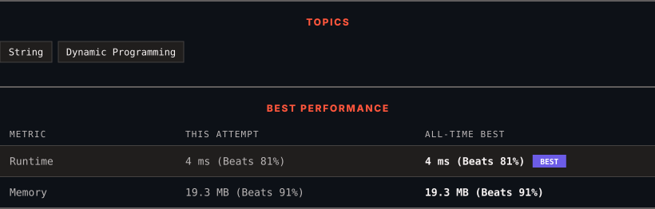

<div align="center">

# 97. Interleaving String

      

[](https://leetcode.com/problems/interleaving-string/)

</div>

---

<div align="center">

<picture>
  <source media="(prefers-color-scheme: dark)" srcset="panel-dark.svg">
  <source media="(prefers-color-scheme: light)" srcset="panel-light.svg">
  
</picture>

</div>

> **New personal best** — Runtime improved on this submission.

### HOW IT WENT

| | |
|:--|:--|
| **Attempts** | first try |
| **Time to solve** | under a minute |
| **Verdicts** | ✅ Accepted |

---

### NOTES

_No notes yet._

---

### SOLUTIONS (1)

| # | File | Language | Date |
|:-:|------|:--------:|:----:|
| 1 | [sol1.py](./sol1.py) | `Python` | 2026-10-19 ← **latest** |

---

### PROBLEM DESCRIPTION

Given strings `s1`, `s2`, and `s3`, find whether `s3` is formed by an **interleaving** of `s1` and `s2`.

An **interleaving** of two strings `s` and `t` is a configuration where `s` and `t` are divided into `n` and `m` substrings respectively, such that:

	- `s = s_1 + s_2 + ... + s_n`

	- `t = t_1 + t_2 + ... + t_m`

	- `|n - m| <= 1`

	- The **interleaving** is `s_1 + t_1 + s_2 + t_2 + s_3 + t_3 + ...` or `t_1 + s_1 + t_2 + s_2 + t_3 + s_3 + ...`

**Note:** `a + b` is the concatenation of strings `a` and `b`.

 

**Example 1:**


```

**Input:** s1 = "aabcc", s2 = "dbbca", s3 = "aadbbcbcac"
**Output:** true
**Explanation:** One way to obtain s3 is:
Split s1 into s1 = "aa" + "bc" + "c", and s2 into s2 = "dbbc" + "a".
Interleaving the two splits, we get "aa" + "dbbc" + "bc" + "a" + "c" = "aadbbcbcac".
Since s3 can be obtained by interleaving s1 and s2, we return true.

```

**Example 2:**

```

**Input:** s1 = "aabcc", s2 = "dbbca", s3 = "aadbbbaccc"
**Output:** false
**Explanation:** Notice how it is impossible to interleave s2 with any other string to obtain s3.

```

**Example 3:**

```

**Input:** s1 = "", s2 = "", s3 = ""
**Output:** true

```

 

**Constraints:**

	- `0 <= s1.length, s2.length <= 100`

	- `0 <= s3.length <= 200`

	- `s1`, `s2`, and `s3` consist of lowercase English letters.

 

**Follow up:** Could you solve it using only `O(s2.length)` additional memory space?

---

<div align="center">

<sub>Auto-synced by <strong>LeetSync</strong> · Built by <a href="https://deveshsamant.in/">Devesh Samant</a></sub>

</div>
