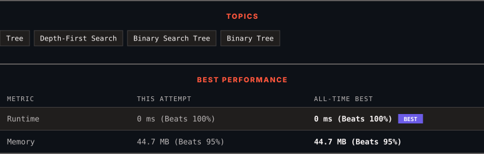

<div align="center">

# 98. Validate Binary Search Tree

      

[](https://leetcode.com/problems/validate-binary-search-tree/)

</div>

---

<div align="center">

<picture>
  <source media="(prefers-color-scheme: dark)" srcset="panel-dark.svg">
  <source media="(prefers-color-scheme: light)" srcset="panel-light.svg">
  
</picture>

</div>

> **New personal best** — Runtime improved on this submission.

### HOW IT WENT

| | |
|:--|:--|
| **Attempts** | first try |
| **Time to solve** | under a minute |
| **Verdicts** | ✅ Accepted |

---

### NOTES

_No notes yet._

---

### SOLUTIONS (1)

| # | File | Language | Date |
|:-:|------|:--------:|:----:|
| 1 | [sol1.java](./sol1.java) | `Java` | 2026-10-19 ← **latest** |

---

### PROBLEM DESCRIPTION

Given the `root` of a binary tree, *determine if it is a valid binary search tree (BST)*.

A **valid BST** is defined as follows:

	- The left subtree of a node contains only nodes with keys **strictly less than** the node's key.

	- The right subtree of a node contains only nodes with keys **strictly greater than** the node's key.

	- Both the left and right subtrees must also be binary search trees.

 

**Example 1:**


```

**Input:** root = [2,1,3]
**Output:** true

```

**Example 2:**


```

**Input:** root = [5,1,4,null,null,3,6]
**Output:** false
**Explanation:** The root node's value is 5 but its right child's value is 4.

```

 

**Constraints:**

	- The number of nodes in the tree is in the range `[1, 10^4]`.

	- `-2^31 <= Node.val <= 2^31 - 1`

---

<div align="center">

<sub>Auto-synced by <strong>LeetSync</strong> · Built by <a href="https://deveshsamant.in/">Devesh Samant</a></sub>

</div>
