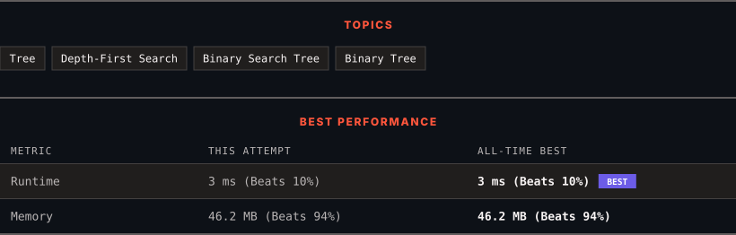

<div align="center">

# 99. Recover Binary Search Tree

      

[](https://leetcode.com/problems/recover-binary-search-tree/)

</div>

---

<div align="center">

<picture>
  <source media="(prefers-color-scheme: dark)" srcset="panel-dark.svg">
  <source media="(prefers-color-scheme: light)" srcset="panel-light.svg">
  
</picture>

</div>

> **New personal best** — Runtime improved on this submission.

### HOW IT WENT

| | |
|:--|:--|
| **Attempts** | first try |
| **Time to solve** | under a minute |
| **Verdicts** | ✅ Accepted |

---

### NOTES

_No notes yet._

---

### SOLUTIONS (1)

| # | File | Language | Date |
|:-:|------|:--------:|:----:|
| 1 | [sol1.java](./sol1.java) | `Java` | 2026-10-19 ← **latest** |

---

### PROBLEM DESCRIPTION

You are given the `root` of a binary search tree (BST), where the values of **exactly** two nodes of the tree were swapped by mistake. *Recover the tree without changing its structure*.

 

**Example 1:**


```

**Input:** root = [1,3,null,null,2]
**Output:** [3,1,null,null,2]
**Explanation:** 3 cannot be a left child of 1 because 3 > 1. Swapping 1 and 3 makes the BST valid.

```

**Example 2:**


```

**Input:** root = [3,1,4,null,null,2]
**Output:** [2,1,4,null,null,3]
**Explanation:** 2 cannot be in the right subtree of 3 because 2 < 3. Swapping 2 and 3 makes the BST valid.

```

 

**Constraints:**

	- The number of nodes in the tree is in the range `[2, 1000]`.

	- `-2^31 <= Node.val <= 2^31 - 1`

 

**Follow up:** A solution using `O(n)` space is pretty straight-forward. Could you devise a constant `O(1)` space solution?

---

<div align="center">

<sub>Auto-synced by <strong>LeetSync</strong> · Built by <a href="https://deveshsamant.in/">Devesh Samant</a></sub>

</div>
