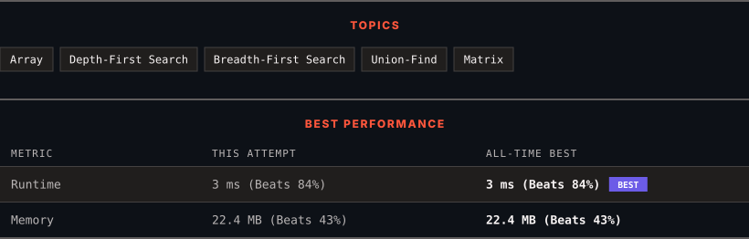

# 130. Surrounded Regions

      

---

<picture>
  <source media="(prefers-color-scheme: dark)" srcset="panel-dark.svg">
  <source media="(prefers-color-scheme: light)" srcset="panel-light.svg">
  
</picture>

> **New personal best** — Runtime improved on this submission.

### HOW IT WENT

| | |
|:--|:--|
| **Attempts** | first try |
| **Time to solve** | 1 min |
| **Verdicts** | ✅ Accepted |

---

### NOTES

_No notes yet._

---

### SOLUTIONS (1)

| # | File | Language | Date |
|:-:|------|:--------:|:----:|
| 1 | [sol1.py](./sol1.py) | `Python` | 2026-10-14 ← **latest** |

---

### PROBLEM DESCRIPTION

You are given an `m x n` matrix `board` containing **letters** `'X'` and `'O'`, **capture regions** that are **surrounded**:

	- **Connect**: A cell is connected to adjacent cells horizontally or vertically.

	- **Region**: To form a region **connect every** `'O'` cell.

	- **Surround**: A region is surrounded if none of the `'O'` cells in that region are on the edge of the board. Such regions are **completely enclosed **by `'X'` cells.

To capture a **surrounded region**, replace all `'O'`s with `'X'`s **in-place** within the original board. You do not need to return anything.

 

**Example 1:**

**Input:** board = [["X","X","X","X"],["X","O","O","X"],["X","X","O","X"],["X","O","X","X"]]

**Output:** [["X","X","X","X"],["X","X","X","X"],["X","X","X","X"],["X","O","X","X"]]

**Explanation:**

In the above diagram, the bottom region is not captured because it is on the edge of the board and cannot be surrounded.

**Example 2:**

**Input:** board = [["X"]]

**Output:** [["X"]]

 

**Constraints:**

	- `m == board.length`

	- `n == board[i].length`

	- `1 <= m, n <= 200`

	- `board[i][j]` is `'X'` or `'O'`.

---

Auto-synced by <strong>LeetSync</strong> · Built by <a href="https://deveshsamant.in/">Devesh Samant</a>

