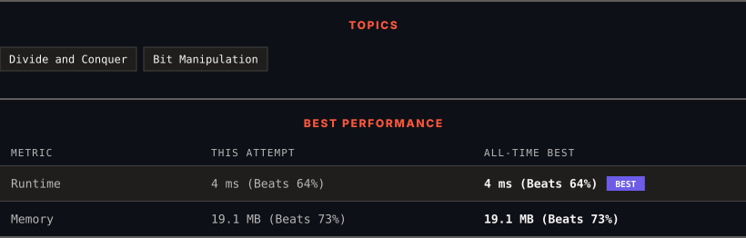

# 190. Reverse Bits

      

---

<picture>
  <source media="(prefers-color-scheme: dark)" srcset="panel-dark.svg">
  <source media="(prefers-color-scheme: light)" srcset="panel-light.svg">
  
</picture>

> **New personal best** — Runtime improved on this submission.

### HOW IT WENT

| | |
|:--|:--|
| **Attempts** | first try |
| **Time to solve** | 1 min |
| **Verdicts** | ✅ Accepted |

---

### NOTES

_No notes yet._

---

### SOLUTIONS (1)

| # | File | Language | Date |
|:-:|------|:--------:|:----:|
| 1 | [sol1.py](./sol1.py) | `Python` | 2026-10-12 ← **latest** |

---

### PROBLEM DESCRIPTION

Reverse bits of a given 32 bits signed integer.

 

**Example 1:**

**Input:** n = 43261596

**Output:** 964176192

**Explanation:**

	
		
			Integer
			Binary
		
		
			43261596
			00000010100101000001111010011100
		
		
			964176192
			00111001011110000010100101000000
		
	

**Example 2:**

**Input:** n = 2147483644

**Output:** 1073741822

**Explanation:**

	
		
			Integer
			Binary
		
		
			2147483644
			01111111111111111111111111111100
		
		
			1073741822
			00111111111111111111111111111110
		
	

 

**Constraints:**

	- `0 <= n <= 2^31 - 2`

	- `n` is even.

 

**Follow up:** If this function is called many times, how would you optimize it?

---

Auto-synced by <strong>LeetSync</strong> · Built by <a href="https://deveshsamant.in/">Devesh Samant</a>

