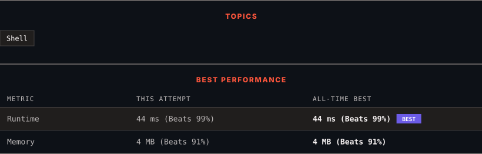

<div align="center">

# 194. Transpose File

      

[](https://leetcode.com/problems/transpose-file/)

</div>

---

<div align="center">

<picture>
  <source media="(prefers-color-scheme: dark)" srcset="panel-dark.svg">
  <source media="(prefers-color-scheme: light)" srcset="panel-light.svg">
  
</picture>

</div>

> **New personal best** — Runtime improved on this submission.

### HOW IT WENT

| | |
|:--|:--|
| **Attempts** | first try |
| **Time to solve** | 1 min |
| **Verdicts** | ✅ Accepted |

---

### NOTES

_No notes yet._

---

### SOLUTIONS (1)

| # | File | Language | Date |
|:-:|------|:--------:|:----:|
| 1 | [sol1.txt](./sol1.txt) | `bash` | 2026-10-17 ← **latest** |

---

### PROBLEM DESCRIPTION

Given a text file `file.txt`, transpose its content.

You may assume that each row has the same number of columns, and each field is separated by the `' '` character.

**Example:**

If `file.txt` has the following content:

```

name age
alice 21
ryan 30

```

Output the following:

```

name alice ryan
age 21 30

```

---

<div align="center">

<sub>Auto-synced by <strong>LeetSync</strong> · Built by <a href="https://deveshsamant.in/">Devesh Samant</a></sub>

</div>
