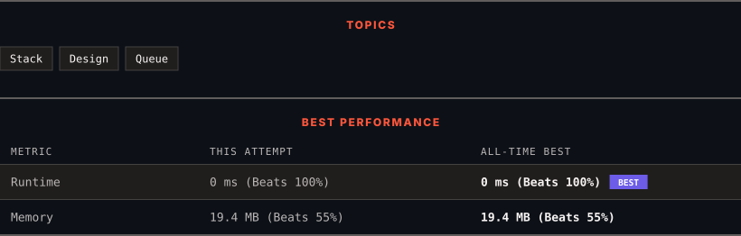

<div align="center">

# 225. Implement Stack using Queues

      

[](https://leetcode.com/problems/implement-stack-using-queues/)

</div>

---

<div align="center">

<picture>
  <source media="(prefers-color-scheme: dark)" srcset="panel-dark.svg">
  <source media="(prefers-color-scheme: light)" srcset="panel-light.svg">
  
</picture>

</div>

> **New personal best** — Runtime improved on this submission.

### HOW IT WENT

| | |
|:--|:--|
| **Attempts** | first try |
| **Time to solve** | 1 min |
| **Verdicts** | ✅ Accepted |

---

### NOTES

_No notes yet._

---

### SOLUTIONS (1)

| # | File | Language | Date |
|:-:|------|:--------:|:----:|
| 1 | [sol1.py](./sol1.py) | `Python` | 2026-10-13 ← **latest** |

---

### PROBLEM DESCRIPTION

Implement a last-in-first-out (LIFO) stack using only two queues. The implemented stack should support all the functions of a normal stack (`push`, `top`, `pop`, and `empty`).

Implement the `MyStack` class:

	- `void push(int x)` Pushes element x to the top of the stack.

	- `int pop()` Removes the element on the top of the stack and returns it.

	- `int top()` Returns the element on the top of the stack.

	- `boolean empty()` Returns `true` if the stack is empty, `false` otherwise.

**Notes:**

	- You must use **only** standard operations of a queue, which means that only `push to back`, `peek/pop from front`, `size` and `is empty` operations are valid.

	- Depending on your language, the queue may not be supported natively. You may simulate a queue using a list or deque (double-ended queue) as long as you use only a queue's standard operations.

 

**Example 1:**

```

**Input**
["MyStack", "push", "push", "top", "pop", "empty"]
[[], [1], [2], [], [], []]
**Output**
[null, null, null, 2, 2, false]

**Explanation**
MyStack myStack = new MyStack();
myStack.push(1);
myStack.push(2);
myStack.top(); // return 2
myStack.pop(); // return 2
myStack.empty(); // return False

```

 

**Constraints:**

	- `1 <= x <= 9`

	- At most `100` calls will be made to `push`, `pop`, `top`, and `empty`.

	- All the calls to `pop` and `top` are valid.

 

**Follow-up:** Can you implement the stack using only one queue?

---

<div align="center">

<sub>Auto-synced by <strong>LeetSync</strong> · Built by <a href="https://deveshsamant.in/">Devesh Samant</a></sub>

</div>
