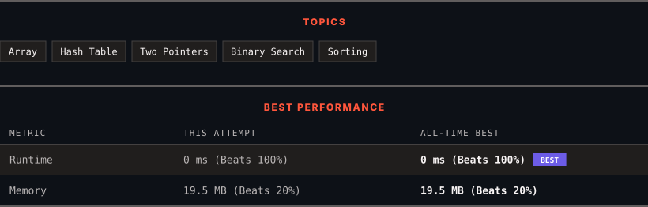

<div align="center">

# 350. Intersection of Two Arrays II

      

[](https://leetcode.com/problems/intersection-of-two-arrays-ii/)

</div>

---

<div align="center">

<picture>
  <source media="(prefers-color-scheme: dark)" srcset="panel-dark.svg">
  <source media="(prefers-color-scheme: light)" srcset="panel-light.svg">
  
</picture>

</div>

> **New personal best** — Runtime improved on this submission.

### HOW IT WENT

| | |
|:--|:--|
| **Attempts** | first try |
| **Time to solve** | under a minute |
| **Verdicts** | ✅ Accepted |

---

### NOTES

_No notes yet._

---

### SOLUTIONS (1)

| # | File | Language | Date |
|:-:|------|:--------:|:----:|
| 1 | [sol1.py](./sol1.py) | `Python` | 2026-10-10 ← **latest** |

---

### PROBLEM DESCRIPTION

Given two integer arrays `nums1` and `nums2`, return *an array of their intersection*. Each element in the result must appear as many times as it shows in both arrays and you may return the result in **any order**.

 

**Example 1:**

```

**Input:** nums1 = [1,2,2,1], nums2 = [2,2]
**Output:** [2,2]

```

**Example 2:**

```

**Input:** nums1 = [4,9,5], nums2 = [9,4,9,8,4]
**Output:** [4,9]
**Explanation:** [9,4] is also accepted.

```

 

**Constraints:**

	- `1 <= nums1.length, nums2.length <= 1000`

	- `0 <= nums1[i], nums2[i] <= 1000`

 

**Follow up:**

	- What if the given array is already sorted? How would you optimize your algorithm?

	- What if `nums1`'s size is small compared to `nums2`'s size? Which algorithm is better?

	- What if elements of `nums2` are stored on disk, and the memory is limited such that you cannot load all elements into the memory at once?

---

<div align="center">

<sub>Auto-synced by <strong>LeetSync</strong> · Built by <a href="https://deveshsamant.in/">Devesh Samant</a></sub>

</div>
