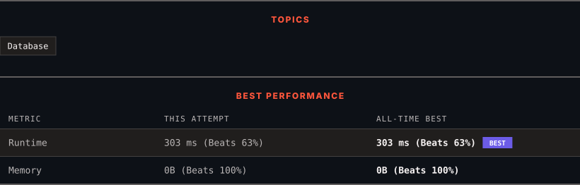

<div align="center">

# 595. Big Countries

      

[](https://leetcode.com/problems/big-countries/)

</div>

---

<div align="center">

<picture>
  <source media="(prefers-color-scheme: dark)" srcset="panel-dark.svg">
  <source media="(prefers-color-scheme: light)" srcset="panel-light.svg">
  
</picture>

</div>

> **New personal best** — Runtime improved on this submission.

### HOW IT WENT

| | |
|:--|:--|
| **Attempts** | first try |
| **Time to solve** | under a minute |
| **Verdicts** | ✅ Accepted |

---

### NOTES

_No notes yet._

---

### SOLUTIONS (1)

| # | File | Language | Date |
|:-:|------|:--------:|:----:|
| 1 | [sol1.sql](./sol1.sql) | `MySQL` | 2026-10-18 ← **latest** |

---

### PROBLEM DESCRIPTION

Table: `World`

```

+-------------+---------+
| Column Name | Type    |
+-------------+---------+
| name        | varchar |
| continent   | varchar |
| area        | int     |
| population  | int     |
| gdp         | bigint  |
+-------------+---------+
name is the primary key (column with unique values) for this table.
Each row of this table gives information about the name of a country, the continent to which it belongs, its area, the population, and its GDP value.

```

 

A country is **big** if:

	- it has an area of at least three million (i.e., `3000000 km^2`), or

	- it has a population of at least twenty-five million (i.e., `25000000`).

Write a solution to find the name, population, and area of the **big countries**.

Return the result table in **any order**.

The result format is in the following example.

 

**Example 1:**

```

**Input:** 
World table:
+-------------+-----------+---------+------------+--------------+
| name        | continent | area    | population | gdp          |
+-------------+-----------+---------+------------+--------------+
| Afghanistan | Asia      | 652230  | 25500100   | 20343000000  |
| Albania     | Europe    | 28748   | 2831741    | 12960000000  |
| Algeria     | Africa    | 2381741 | 37100000   | 188681000000 |
| Andorra     | Europe    | 468     | 78115      | 3712000000   |
| Angola      | Africa    | 1246700 | 20609294   | 100990000000 |
+-------------+-----------+---------+------------+--------------+
**Output:** 
+-------------+------------+---------+
| name        | population | area    |
+-------------+------------+---------+
| Afghanistan | 25500100   | 652230  |
| Algeria     | 37100000   | 2381741 |
+-------------+------------+---------+

```

---

<div align="center">

<sub>Auto-synced by <strong>LeetSync</strong> · Built by <a href="https://deveshsamant.in/">Devesh Samant</a></sub>

</div>
