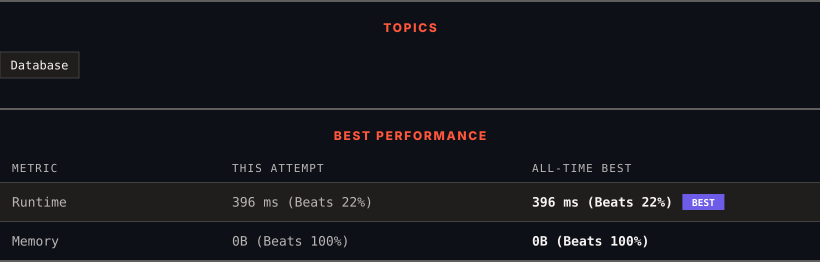

<div align="center">

# 596. Classes With at Least 5 Students

      

[](https://leetcode.com/problems/classes-with-at-least-5-students/)

</div>

---

<div align="center">

<picture>
  <source media="(prefers-color-scheme: dark)" srcset="panel-dark.svg">
  <source media="(prefers-color-scheme: light)" srcset="panel-light.svg">
  
</picture>

</div>

> **New personal best** — Runtime improved on this submission.

### HOW IT WENT

| | |
|:--|:--|
| **Attempts** | first try |
| **Time to solve** | under a minute |
| **Verdicts** | ✅ Accepted |

---

### NOTES

_No notes yet._

---

### SOLUTIONS (1)

| # | File | Language | Date |
|:-:|------|:--------:|:----:|
| 1 | [sol1.sql](./sol1.sql) | `MySQL` | 2026-10-18 ← **latest** |

---

### PROBLEM DESCRIPTION

Table: `Courses`

```

+-------------+---------+
| Column Name | Type    |
+-------------+---------+
| student     | varchar |
| class       | varchar |
+-------------+---------+
(student, class) is the primary key (combination of columns with unique values) for this table.
Each row of this table indicates the name of a student and the class in which they are enrolled.

```

 

Write a solution to find all the classes that have **at least five students**.

Return the result table in **any order**.

The result format is in the following example.

 

**Example 1:**

```

**Input:** 
Courses table:
+---------+----------+
| student | class    |
+---------+----------+
| A       | Math     |
| B       | English  |
| C       | Math     |
| D       | Biology  |
| E       | Math     |
| F       | Computer |
| G       | Math     |
| H       | Math     |
| I       | Math     |
+---------+----------+
**Output:** 
+---------+
| class   |
+---------+
| Math    |
+---------+
**Explanation:** 
- Math has 6 students, so we include it.
- English has 1 student, so we do not include it.
- Biology has 1 student, so we do not include it.
- Computer has 1 student, so we do not include it.

```

---

<div align="center">

<sub>Auto-synced by <strong>LeetSync</strong> · Built by <a href="https://deveshsamant.in/">Devesh Samant</a></sub>

</div>
