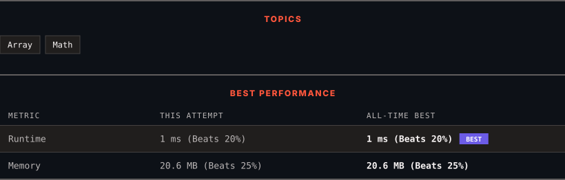

<div align="center">

# 598. Range Addition II

      

[](https://leetcode.com/problems/range-addition-ii/)

</div>

---

<div align="center">

<picture>
  <source media="(prefers-color-scheme: dark)" srcset="panel-dark.svg">
  <source media="(prefers-color-scheme: light)" srcset="panel-light.svg">
  
</picture>

</div>

> **New personal best** — Runtime improved on this submission.

### HOW IT WENT

| | |
|:--|:--|
| **Attempts** | first try |
| **Time to solve** | under a minute |
| **Verdicts** | ✅ Accepted |

---

### NOTES

_No notes yet._

---

### SOLUTIONS (1)

| # | File | Language | Date |
|:-:|------|:--------:|:----:|
| 1 | [sol1.py](./sol1.py) | `Python` | 2026-10-18 ← **latest** |

---

### PROBLEM DESCRIPTION

You are given an `m x n` matrix `M` initialized with all `0`'s and an array of operations `ops`, where `ops[i] = [a_i, b_i]` means `M[x][y]` should be incremented by one for all `0 <= x < a_i` and `0 <= y < b_i`.

Count and return *the number of maximum integers in the matrix after performing all the operations*.

 

**Example 1:**


```

**Input:** m = 3, n = 3, ops = [[2,2],[3,3]]
**Output:** 4
**Explanation:** The maximum integer in M is 2, and there are four of it in M. So return 4.

```

**Example 2:**

```

**Input:** m = 3, n = 3, ops = [[2,2],[3,3],[3,3],[3,3],[2,2],[3,3],[3,3],[3,3],[2,2],[3,3],[3,3],[3,3]]
**Output:** 4

```

**Example 3:**

```

**Input:** m = 3, n = 3, ops = []
**Output:** 9

```

 

**Constraints:**

	- `1 <= m, n <= 4 * 10^4`

	- `0 <= ops.length <= 10^4`

	- `ops[i].length == 2`

	- `1 <= a_i <= m`

	- `1 <= b_i <= n`

---

<div align="center">

<sub>Auto-synced by <strong>LeetSync</strong> · Built by <a href="https://deveshsamant.in/">Devesh Samant</a></sub>

</div>
