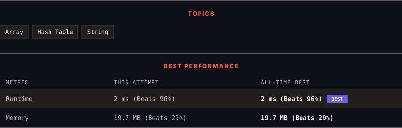

<div align="center">

# 599. Minimum Index Sum of Two Lists

      

[](https://leetcode.com/problems/minimum-index-sum-of-two-lists/)

</div>

---

<div align="center">

<picture>
  <source media="(prefers-color-scheme: dark)" srcset="panel-dark.svg">
  <source media="(prefers-color-scheme: light)" srcset="panel-light.svg">
  
</picture>

</div>

> **New personal best** — Runtime improved on this submission.

### HOW IT WENT

| | |
|:--|:--|
| **Attempts** | first try |
| **Time to solve** | under a minute |
| **Verdicts** | ✅ Accepted |

---

### NOTES

_No notes yet._

---

### SOLUTIONS (1)

| # | File | Language | Date |
|:-:|------|:--------:|:----:|
| 1 | [sol1.py](./sol1.py) | `Python` | 2026-10-18 ← **latest** |

---

### PROBLEM DESCRIPTION

Given two arrays of strings `list1` and `list2`, find the **common strings with the least index sum**.

A **common string** is a string that appeared in both `list1` and `list2`.

A **common string with the least index sum** is a common string such that if it appeared at `list1[i]` and `list2[j]` then `i + j` should be the minimum value among all the other **common strings**.

Return *all the **common strings with the least index sum***. Return the answer in **any order**.

 

**Example 1:**

```

**Input:** list1 = ["Shogun","Tapioca Express","Burger King","KFC"], list2 = ["Piatti","The Grill at Torrey Pines","Hungry Hunter Steakhouse","Shogun"]
**Output:** ["Shogun"]
**Explanation:** The only common string is "Shogun".

```

**Example 2:**

```

**Input:** list1 = ["Shogun","Tapioca Express","Burger King","KFC"], list2 = ["KFC","Shogun","Burger King"]
**Output:** ["Shogun"]
**Explanation:** The common string with the least index sum is "Shogun" with index sum = (0 + 1) = 1.

```

**Example 3:**

```

**Input:** list1 = ["happy","sad","good"], list2 = ["sad","happy","good"]
**Output:** ["sad","happy"]
**Explanation:** There are three common strings:
"happy" with index sum = (0 + 1) = 1.
"sad" with index sum = (1 + 0) = 1.
"good" with index sum = (2 + 2) = 4.
The strings with the least index sum are "sad" and "happy".

```

 

**Constraints:**

	- `1 <= list1.length, list2.length <= 1000`

	- `1 <= list1[i].length, list2[i].length <= 30`

	- `list1[i]` and `list2[i]` consist of spaces `' '` and English letters.

	- All the strings of `list1` are **unique**.

	- All the strings of `list2` are **unique**.

	- There is at least a common string between `list1` and `list2`.

---

<div align="center">

<sub>Auto-synced by <strong>LeetSync</strong> · Built by <a href="https://deveshsamant.in/">Devesh Samant</a></sub>

</div>
