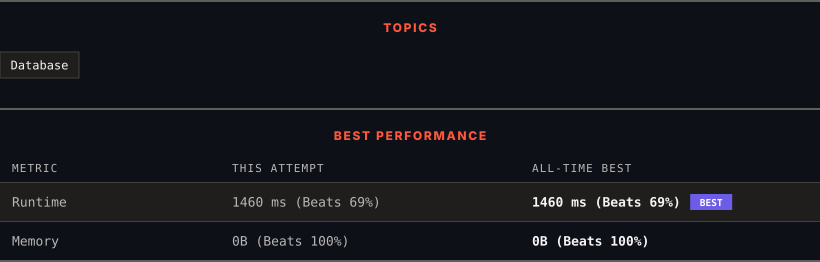

<div align="center">

# 607. Sales Person

      

[](https://leetcode.com/problems/sales-person/)

</div>

---

<div align="center">

<picture>
  <source media="(prefers-color-scheme: dark)" srcset="panel-dark.svg">
  <source media="(prefers-color-scheme: light)" srcset="panel-light.svg">
  
</picture>

</div>

> **New personal best** — Runtime improved on this submission.

### HOW IT WENT

| | |
|:--|:--|
| **Attempts** | first try |
| **Time to solve** | under a minute |
| **Verdicts** | ✅ Accepted |

---

### NOTES

_No notes yet._

---

### SOLUTIONS (1)

| # | File | Language | Date |
|:-:|------|:--------:|:----:|
| 1 | [sol1.sql](./sol1.sql) | `MySQL` | 2026-10-18 ← **latest** |

---

### PROBLEM DESCRIPTION

Table: `SalesPerson`

```

+-----------------+---------+
| Column Name     | Type    |
+-----------------+---------+
| sales_id        | int     |
| name            | varchar |
| salary          | int     |
| commission_rate | int     |
| hire_date       | date    |
+-----------------+---------+
sales_id is the primary key (column with unique values) for this table.
Each row of this table indicates the name and the ID of a salesperson alongside their salary, commission rate, and hire date.

```

 

Table: `Company`

```

+-------------+---------+
| Column Name | Type    |
+-------------+---------+
| com_id      | int     |
| name        | varchar |
| city        | varchar |
+-------------+---------+
com_id is the primary key (column with unique values) for this table.
Each row of this table indicates the name and the ID of a company and the city in which the company is located.

```

 

Table: `Orders`

```

+-------------+------+
| Column Name | Type |
+-------------+------+
| order_id    | int  |
| order_date  | date |
| com_id      | int  |
| sales_id    | int  |
| amount      | int  |
+-------------+------+
order_id is the primary key (column with unique values) for this table.
com_id is a foreign key (reference column) to com_id from the Company table.
sales_id is a foreign key (reference column) to sales_id from the SalesPerson table.
Each row of this table contains information about one order. This includes the ID of the company, the ID of the salesperson, the date of the order, and the amount paid.

```

 

Write a solution to find the names of all the salespersons who did not have any orders related to the company with the name **"RED"**.

Return the result table in **any order**.

The result format is in the following example.

 

**Example 1:**

```

**Input:** 
SalesPerson table:
+----------+------+--------+-----------------+------------+
| sales_id | name | salary | commission_rate | hire_date  |
+----------+------+--------+-----------------+------------+
| 1        | John | 100000 | 6               | 4/1/2006   |
| 2        | Amy  | 12000  | 5               | 5/1/2010   |
| 3        | Mark | 65000  | 12              | 12/25/2008 |
| 4        | Pam  | 25000  | 25              | 1/1/2005   |
| 5        | Alex | 5000   | 10              | 2/3/2007   |
+----------+------+--------+-----------------+------------+
Company table:
+--------+--------+----------+
| com_id | name   | city     |
+--------+--------+----------+
| 1      | RED    | Boston   |
| 2      | ORANGE | New York |
| 3      | YELLOW | Boston   |
| 4      | GREEN  | Austin   |
+--------+--------+----------+
Orders table:
+----------+------------+--------+----------+--------+
| order_id | order_date | com_id | sales_id | amount |
+----------+------------+--------+----------+--------+
| 1        | 1/1/2014   | 3      | 4        | 10000  |
| 2        | 2/1/2014   | 4      | 5        | 5000   |
| 3        | 3/1/2014   | 1      | 1        | 50000  |
| 4        | 4/1/2014   | 1      | 4        | 25000  |
+----------+------------+--------+----------+--------+
**Output:** 
+------+
| name |
+------+
| Amy  |
| Mark |
| Alex |
+------+
**Explanation:** 
According to orders 3 and 4 in the Orders table, it is easy to tell that only salesperson John and Pam have sales to company RED, so we report all the other names in the table salesperson.

```

---

<div align="center">

<sub>Auto-synced by <strong>LeetSync</strong> · Built by <a href="https://deveshsamant.in/">Devesh Samant</a></sub>

</div>
