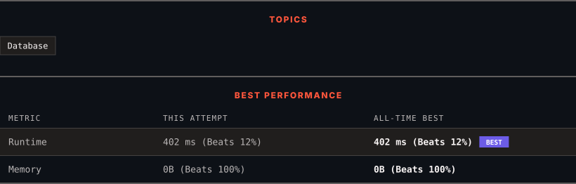

<div align="center">

# 610. Triangle Judgement

      

[](https://leetcode.com/problems/triangle-judgement/)

</div>

---

<div align="center">

<picture>
  <source media="(prefers-color-scheme: dark)" srcset="panel-dark.svg">
  <source media="(prefers-color-scheme: light)" srcset="panel-light.svg">
  
</picture>

</div>

> **New personal best** — Runtime improved on this submission.

### HOW IT WENT

| | |
|:--|:--|
| **Attempts** | first try |
| **Time to solve** | under a minute |
| **Verdicts** | ✅ Accepted |

---

### NOTES

_No notes yet._

---

### SOLUTIONS (1)

| # | File | Language | Date |
|:-:|------|:--------:|:----:|
| 1 | [sol1.sql](./sol1.sql) | `MySQL` | 2026-10-18 ← **latest** |

---

### PROBLEM DESCRIPTION

Table: `Triangle`

```

+-------------+------+
| Column Name | Type |
+-------------+------+
| x           | int  |
| y           | int  |
| z           | int  |
+-------------+------+
In SQL, (x, y, z) is the primary key column for this table.
Each row of this table contains the lengths of three line segments.

```

 

Report for every three line segments whether they can form a triangle.

Return the result table in **any order**.

The result format is in the following example.

 

**Example 1:**

```

**Input:** 
Triangle table:
+----+----+----+
| x  | y  | z  |
+----+----+----+
| 13 | 15 | 30 |
| 10 | 20 | 15 |
+----+----+----+
**Output:** 
+----+----+----+----------+
| x  | y  | z  | triangle |
+----+----+----+----------+
| 13 | 15 | 30 | No       |
| 10 | 20 | 15 | Yes      |
+----+----+----+----------+

```

---

<div align="center">

<sub>Auto-synced by <strong>LeetSync</strong> · Built by <a href="https://deveshsamant.in/">Devesh Samant</a></sub>

</div>
