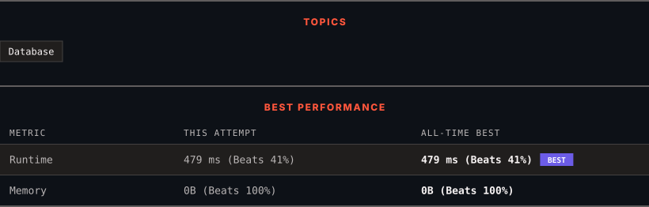

<div align="center">

# 619. Biggest Single Number

      

[](https://leetcode.com/problems/biggest-single-number/)

</div>

---

<div align="center">

<picture>
  <source media="(prefers-color-scheme: dark)" srcset="panel-dark.svg">
  <source media="(prefers-color-scheme: light)" srcset="panel-light.svg">
  
</picture>

</div>

> **New personal best** — Runtime improved on this submission.

### HOW IT WENT

| | |
|:--|:--|
| **Attempts** | 2 before accepted |
| **Time to solve** | under a minute |
| **Verdicts** | ❌ Wrong Answer → ✅ Accepted |

---

### NOTES

_No notes yet._

---

### SOLUTIONS (1)

| # | File | Language | Date |
|:-:|------|:--------:|:----:|
| 1 | [sol1.sql](./sol1.sql) | `MySQL` | 2026-10-18 ← **latest** |

---

### PROBLEM DESCRIPTION

Table: `MyNumbers`

```

+-------------+------+
| Column Name | Type |
+-------------+------+
| num         | int  |
+-------------+------+
This table may contain duplicates (In other words, there is no primary key for this table in SQL).
Each row of this table contains an integer.

```

 

A **single number** is a number that appeared only once in the `MyNumbers` table.

Find the largest **single number**. If there is no **single number**, report `null`.

The result format is in the following example.

 
 

**Example 1:**

```

**Input:** 
MyNumbers table:
+-----+
| num |
+-----+
| 8   |
| 8   |
| 3   |
| 3   |
| 1   |
| 4   |
| 5   |
| 6   |
+-----+
**Output:** 
+-----+
| num |
+-----+
| 6   |
+-----+
**Explanation:** The single numbers are 1, 4, 5, and 6.
Since 6 is the largest single number, we return it.

```

**Example 2:**

```

**Input:** 
MyNumbers table:
+-----+
| num |
+-----+
| 8   |
| 8   |
| 7   |
| 7   |
| 3   |
| 3   |
| 3   |
+-----+
**Output:** 
+------+
| num  |
+------+
| null |
+------+
**Explanation:** There are no single numbers in the input table so we return null.

```

---

<div align="center">

<sub>Auto-synced by <strong>LeetSync</strong> · Built by <a href="https://deveshsamant.in/">Devesh Samant</a></sub>

</div>
