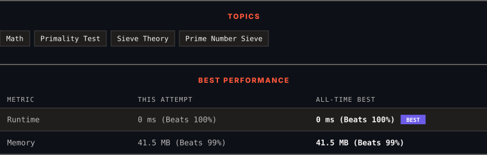

<div align="center">

# 1175. Prime Arrangements

      

[](https://leetcode.com/problems/prime-arrangements/)

</div>

---

<div align="center">

<picture>
  <source media="(prefers-color-scheme: dark)" srcset="panel-dark.svg">
  <source media="(prefers-color-scheme: light)" srcset="panel-light.svg">
  
</picture>

</div>

> **New personal best** — Runtime improved on this submission.

### HOW IT WENT

| | |
|:--|:--|
| **Attempts** | first try |
| **Time to solve** | 1 min |
| **Verdicts** | ✅ Accepted |

---

### NOTES

_No notes yet._

---

### SOLUTIONS (1)

| # | File | Language | Date |
|:-:|------|:--------:|:----:|
| 1 | [sol1.java](./sol1.java) | `Java` | 2026-10-20 ← **latest** |

---

### PROBLEM DESCRIPTION

Return the number of permutations of 1 to `n` so that prime numbers are at prime indices (1-indexed.)

*(Recall that an integer is prime if and only if it is greater than 1, and cannot be written as a product of two positive integers both smaller than it.)*

Since the answer may be large, return the answer **modulo `10^9 + 7`**.

 

**Example 1:**

```

**Input:** n = 5
**Output:** 12
**Explanation:** For example [1,2,5,4,3] is a valid permutation, but [5,2,3,4,1] is not because the prime number 5 is at index 1.

```

**Example 2:**

```

**Input:** n = 100
**Output:** 682289015

```

 

**Constraints:**

	- `1 <= n <= 100`

---

<div align="center">

<sub>Auto-synced by <strong>LeetSync</strong> · Built by <a href="https://deveshsamant.in/">Devesh Samant</a></sub>

</div>
