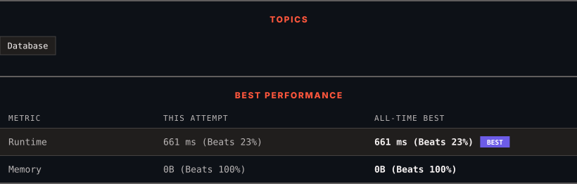

<div align="center">

# 1179. Reformat Department Table

      

[](https://leetcode.com/problems/reformat-department-table/)

</div>

---

<div align="center">

<picture>
  <source media="(prefers-color-scheme: dark)" srcset="panel-dark.svg">
  <source media="(prefers-color-scheme: light)" srcset="panel-light.svg">
  
</picture>

</div>

> **New personal best** — Runtime improved on this submission.

### HOW IT WENT

| | |
|:--|:--|
| **Attempts** | first try |
| **Time to solve** | under a minute |
| **Verdicts** | ✅ Accepted |

---

### NOTES

_No notes yet._

---

### SOLUTIONS (1)

| # | File | Language | Date |
|:-:|------|:--------:|:----:|
| 1 | [sol1.sql](./sol1.sql) | `MySQL` | 2026-10-20 ← **latest** |

---

### PROBLEM DESCRIPTION

Table: `Department`

```

+-------------+---------+
| Column Name | Type    |
+-------------+---------+
| id          | int     |
| revenue     | int     |
| month       | varchar |
+-------------+---------+
In SQL,(id, month) is the primary key of this table.
The table has information about the revenue of each department per month.
The month has values in ["Jan","Feb","Mar","Apr","May","Jun","Jul","Aug","Sep","Oct","Nov","Dec"].

```

 

Reformat the table such that there is a department id column and a revenue column **for each month**.

Return the result table in **any order**.

The result format is in the following example.

 

**Example 1:**

```

**Input:** 
Department table:
+------+---------+-------+
| id   | revenue | month |
+------+---------+-------+
| 1    | 8000    | Jan   |
| 2    | 9000    | Jan   |
| 3    | 10000   | Feb   |
| 1    | 7000    | Feb   |
| 1    | 6000    | Mar   |
+------+---------+-------+
**Output:** 
+------+-------------+-------------+-------------+-----+-------------+
| id   | Jan_Revenue | Feb_Revenue | Mar_Revenue | ... | Dec_Revenue |
+------+-------------+-------------+-------------+-----+-------------+
| 1    | 8000        | 7000        | 6000        | ... | null        |
| 2    | 9000        | null        | null        | ... | null        |
| 3    | null        | 10000       | null        | ... | null        |
+------+-------------+-------------+-------------+-----+-------------+
**Explanation:** The revenue from Apr to Dec is null.
Note that the result table has 13 columns (1 for the department id + 12 for the months).

```

---

<div align="center">

<sub>Auto-synced by <strong>LeetSync</strong> · Built by <a href="https://deveshsamant.in/">Devesh Samant</a></sub>

</div>
