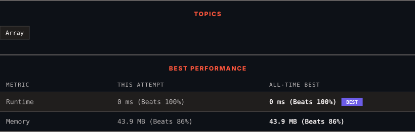

<div align="center">

# 1184. Distance Between Bus Stops

      

[](https://leetcode.com/problems/distance-between-bus-stops/)

</div>

---

<div align="center">

<picture>
  <source media="(prefers-color-scheme: dark)" srcset="panel-dark.svg">
  <source media="(prefers-color-scheme: light)" srcset="panel-light.svg">
  
</picture>

</div>

> **New personal best** — Runtime improved on this submission.

### HOW IT WENT

| | |
|:--|:--|
| **Attempts** | 2 before accepted |
| **Time to solve** | 1 min |
| **Verdicts** | 🔧 Compile Error → ✅ Accepted |

---

### NOTES

_No notes yet._

---

### SOLUTIONS (1)

| # | File | Language | Date |
|:-:|------|:--------:|:----:|
| 1 | [sol1.java](./sol1.java) | `Java` | 2026-10-20 ← **latest** |

---

### PROBLEM DESCRIPTION

A bus has `n` stops numbered from `0` to `n - 1` that form a circle. We know the distance between all pairs of neighboring stops where `distance[i]` is the distance between the stops number `i` and `(i + 1) % n`.


The bus goes along both directions i.e. clockwise and counterclockwise.


Return the shortest distance between the given `start` and `destination` stops.


 


**Example 1:**


```

**Input:** distance = [1,2,3,4], start = 0, destination = 1
**Output:** 1
**Explanation:** Distance between 0 and 1 is 1 or 9, minimum is 1.
```


 


**Example 2:**


```

**Input:** distance = [1,2,3,4], start = 0, destination = 2
**Output:** 3
**Explanation:** Distance between 0 and 2 is 3 or 7, minimum is 3.

```


 


**Example 3:**


```

**Input:** distance = [1,2,3,4], start = 0, destination = 3
**Output:** 4
**Explanation:** Distance between 0 and 3 is 6 or 4, minimum is 4.

```


 


**Constraints:**


	- `1 <= n <= 10^4`

	- `distance.length == n`

	- `0 <= start, destination < n`

	- `0 <= distance[i] <= 10^4`

---

<div align="center">

<sub>Auto-synced by <strong>LeetSync</strong> · Built by <a href="https://deveshsamant.in/">Devesh Samant</a></sub>

</div>
