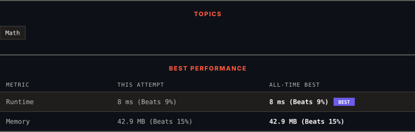

<div align="center">

# 1185. Day of the Week

      

[](https://leetcode.com/problems/day-of-the-week/)

</div>

---

<div align="center">

<picture>
  <source media="(prefers-color-scheme: dark)" srcset="panel-dark.svg">
  <source media="(prefers-color-scheme: light)" srcset="panel-light.svg">
  
</picture>

</div>

> **New personal best** — Runtime improved on this submission.

### HOW IT WENT

| | |
|:--|:--|
| **Attempts** | first try |
| **Time to solve** | under a minute |
| **Verdicts** | ✅ Accepted |

---

### NOTES

_No notes yet._

---

### SOLUTIONS (1)

| # | File | Language | Date |
|:-:|------|:--------:|:----:|
| 1 | [sol1.java](./sol1.java) | `Java` | 2026-10-20 ← **latest** |

---

### PROBLEM DESCRIPTION

Given a date, return the corresponding day of the week for that date.

The input is given as three integers representing the `day`, `month` and `year` respectively.

Return the answer as one of the following values `{"Sunday", "Monday", "Tuesday", "Wednesday", "Thursday", "Friday", "Saturday"}`.

**Note:** January 1, 1971 was a Friday.

 

**Example 1:**

```

**Input:** day = 31, month = 8, year = 2019
**Output:** "Saturday"

```

**Example 2:**

```

**Input:** day = 18, month = 7, year = 1999
**Output:** "Sunday"

```

**Example 3:**

```

**Input:** day = 15, month = 8, year = 1993
**Output:** "Sunday"

```

 

**Constraints:**

	- The given dates are valid dates between the years `1971` and `2100`.

---

<div align="center">

<sub>Auto-synced by <strong>LeetSync</strong> · Built by <a href="https://deveshsamant.in/">Devesh Samant</a></sub>

</div>
