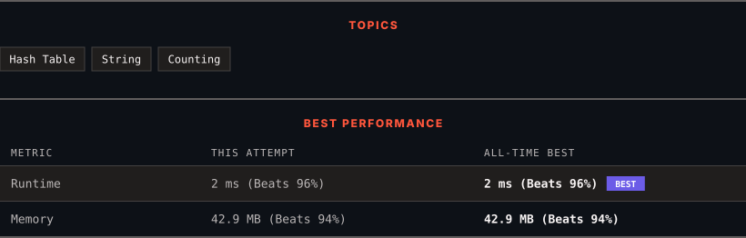

<div align="center">

# 1189. Maximum Number of Balloons

      

[](https://leetcode.com/problems/maximum-number-of-balloons/)

</div>

---

<div align="center">

<picture>
  <source media="(prefers-color-scheme: dark)" srcset="panel-dark.svg">
  <source media="(prefers-color-scheme: light)" srcset="panel-light.svg">
  
</picture>

</div>

> **New personal best** — Runtime improved on this submission.

### HOW IT WENT

| | |
|:--|:--|
| **Attempts** | first try |
| **Time to solve** | under a minute |
| **Verdicts** | ✅ Accepted |

---

### NOTES

_No notes yet._

---

### SOLUTIONS (1)

| # | File | Language | Date |
|:-:|------|:--------:|:----:|
| 1 | [sol1.java](./sol1.java) | `Java` | 2026-10-20 ← **latest** |

---

### PROBLEM DESCRIPTION

Given a string `text`, you want to use the characters of `text` to form as many instances of the word **"balloon"** as possible.

You can use each character in `text` **at most once**. Return the maximum number of instances that can be formed.

 

**Example 1:**

****

```

**Input:** text = "nlaebolko"
**Output:** 1

```

**Example 2:**

****

```

**Input:** text = "loonbalxballpoon"
**Output:** 2

```

**Example 3:**

```

**Input:** text = "leetcode"
**Output:** 0

```

 

**Constraints:**

	- `1 <= text.length <= 10^4`

	- `text` consists of lower case English letters only.

 

**Note:** This question is the same as [ 2287: Rearrange Characters to Make Target String.](https://leetcode.com/problems/rearrange-characters-to-make-target-string/description/)

---

<div align="center">

<sub>Auto-synced by <strong>LeetSync</strong> · Built by <a href="https://deveshsamant.in/">Devesh Samant</a></sub>

</div>
