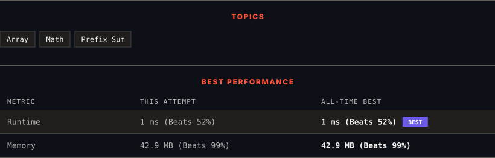

# 3432. Count Partitions with Even Sum Difference

      

---

<picture>
  <source media="(prefers-color-scheme: dark)" srcset="panel-dark.svg">
  <source media="(prefers-color-scheme: light)" srcset="panel-light.svg">
  
</picture>

> **New personal best** — Runtime improved on this submission.

### HOW IT WENT

| | |
|:--|:--|
| **Attempts** | first try |
| **Time to solve** | under a minute |
| **Verdicts** | ✅ Accepted |

---

### NOTES

_No notes yet._

---

### SOLUTIONS (1)

| # | File | Language | Date |
|:-:|------|:--------:|:----:|
| 1 | [sol1.java](./sol1.java) | `Java` | 2026-10-20 ← **latest** |

---

### PROBLEM DESCRIPTION

You are given an integer array `nums` of length `n`.

A **partition** is defined as an index `i` where `0 <= i < n - 1`, splitting the array into two **non-empty** subarrays such that:

	- Left subarray contains indices `[0, i]`.

	- Right subarray contains indices `[i + 1, n - 1]`.

Return the number of **partitions** where the **difference** between the **sum** of the left and right subarrays is **even**.

 

**Example 1:**

**Input:** nums = [10,10,3,7,6]

**Output:** 4

**Explanation:**

The 4 partitions are:

	- `[10]`, `[10, 3, 7, 6]` with a sum difference of `10 - 26 = -16`, which is even.

	- `[10, 10]`, `[3, 7, 6]` with a sum difference of `20 - 16 = 4`, which is even.

	- `[10, 10, 3]`, `[7, 6]` with a sum difference of `23 - 13 = 10`, which is even.

	- `[10, 10, 3, 7]`, `[6]` with a sum difference of `30 - 6 = 24`, which is even.

**Example 2:**

**Input:** nums = [1,2,2]

**Output:** 0

**Explanation:**

No partition results in an even sum difference.

**Example 3:**

**Input:** nums = [2,4,6,8]

**Output:** 3

**Explanation:**

All partitions result in an even sum difference.

 

**Constraints:**

	- `2 <= n == nums.length <= 100`

	- `1 <= nums[i] <= 100`

---

Auto-synced by <strong>LeetSync</strong> · Built by <a href="https://deveshsamant.in/">Devesh Samant</a>

