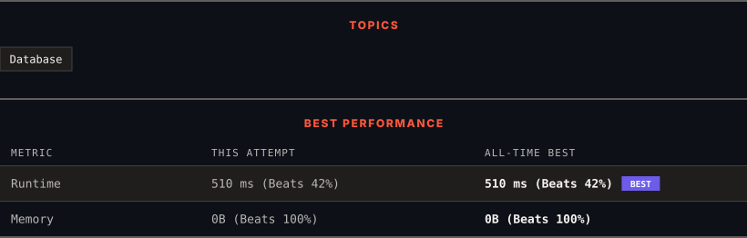

<div align="center">

# 3436. Find Valid Emails

      

[](https://leetcode.com/problems/find-valid-emails/)

</div>

---

<div align="center">

<picture>
  <source media="(prefers-color-scheme: dark)" srcset="panel-dark.svg">
  <source media="(prefers-color-scheme: light)" srcset="panel-light.svg">
  
</picture>

</div>

> **New personal best** — Runtime improved on this submission.

### HOW IT WENT

| | |
|:--|:--|
| **Attempts** | first try |
| **Time to solve** | under a minute |
| **Verdicts** | ✅ Accepted |

---

### NOTES

_No notes yet._

---

### SOLUTIONS (1)

| # | File | Language | Date |
|:-:|------|:--------:|:----:|
| 1 | [sol1.sql](./sol1.sql) | `MySQL` | 2026-10-20 ← **latest** |

---

### PROBLEM DESCRIPTION

Table: `Users`

```

+-----------------+---------+
| Column Name     | Type    |
+-----------------+---------+
| user_id         | int     |
| email           | varchar |
+-----------------+---------+
(user_id) is the unique key for this table.
Each row contains a user's unique ID and email address.

```

Write a solution to find all the **valid email addresses**. A valid email address meets the following criteria:

	- It contains exactly one `@` symbol.

	- It ends with `.com`.

	- The part before the `@` symbol contains only **alphanumeric** characters and **underscores**.

	- The part after the `@` symbol and before `.com` contains a domain name **that contains only letters**.

Return* the result table ordered by* `user_id` *in* **ascending ***order*.

 

**Example:**

**Input:**

Users table:

```

+---------+---------------------+
| user_id | email               |
+---------+---------------------+
| 1       | alice@example.com   |
| 2       | bob_at_example.com  |
| 3       | charlie@example.net |
| 4       | david@domain.com    |
| 5       | eve@invalid         |
+---------+---------------------+

```

**Output:**

```

+---------+-------------------+
| user_id | email             |
+---------+-------------------+
| 1       | alice@example.com |
| 4       | david@domain.com  |
+---------+-------------------+

```

**Explanation:**

	- **alice@example.com** is valid because it contains one `@`, alice is alphanumeric, and example.com starts with a letter and ends with .com.

	- **bob_at_example.com** is invalid because it contains an underscore instead of an `@`.

	- **charlie@example.net** is invalid because the domain does not end with `.com`.

	- **david@domain.com** is valid because it meets all criteria.

	- **eve@invalid** is invalid because the domain does not end with `.com`.

Result table is ordered by user_id in ascending order.

---

<div align="center">

<sub>Auto-synced by <strong>LeetSync</strong> · Built by <a href="https://deveshsamant.in/">Devesh Samant</a></sub>

</div>
