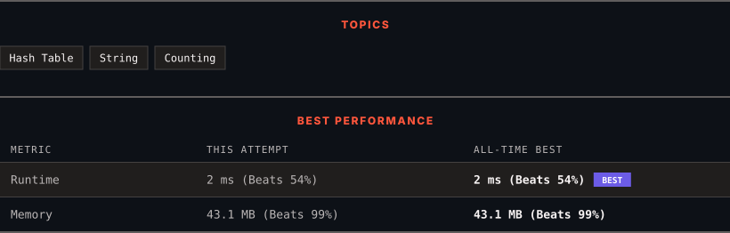

# 3442. Maximum Difference Between Even and Odd Frequency I

      

---

<picture>
  <source media="(prefers-color-scheme: dark)" srcset="panel-dark.svg">
  <source media="(prefers-color-scheme: light)" srcset="panel-light.svg">
  
</picture>

> **New personal best** — Runtime improved on this submission.

### HOW IT WENT

| | |
|:--|:--|
| **Attempts** | first try |
| **Time to solve** | under a minute |
| **Verdicts** | ✅ Accepted |

---

### NOTES

_No notes yet._

---

### SOLUTIONS (1)

| # | File | Language | Date |
|:-:|------|:--------:|:----:|
| 1 | [sol1.java](./sol1.java) | `Java` | 2026-10-20 ← **latest** |

---

### PROBLEM DESCRIPTION

You are given a string `s` consisting of lowercase English letters.

Your task is to find the **maximum** difference `diff = freq(a_1) - freq(a_2)` between the frequency of characters `a_1` and `a_2` in the string such that:

	- `a_1` has an **odd frequency** in the string.

	- `a_2` has an **even frequency** in the string.

Return this **maximum** difference.

 

**Example 1:**

**Input:** s = "aaaaabbc"

**Output:** 3

**Explanation:**

	- The character `'a'` has an **odd frequency** of `5`, and `'b'` has an **even frequency** of `2`.

	- The maximum difference is `5 - 2 = 3`.

**Example 2:**

**Input:** s = "abcabcab"

**Output:** 1

**Explanation:**

	- The character `'a'` has an **odd frequency** of `3`, and `'c'` has an **even frequency** of 2.

	- The maximum difference is `3 - 2 = 1`.

 

**Constraints:**

	- `3 <= s.length <= 100`

	- `s` consists only of lowercase English letters.

	- `s` contains at least one character with an odd frequency and one with an even frequency.

---

Auto-synced by <strong>LeetSync</strong> · Built by <a href="https://deveshsamant.in/">Devesh Samant</a>

